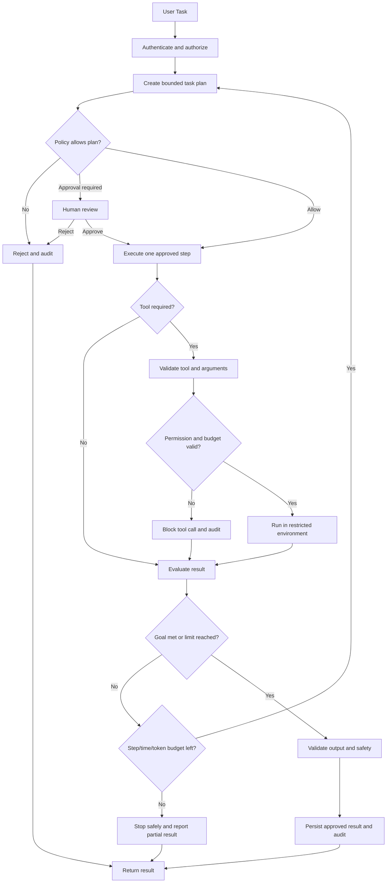

# Agent Workflow Diagram

This is a bounded, policy-controlled agent workflow. It does not authorize unrestricted autonomous operation.

## Agent invariants

1. The user authorization scope is inherited; an agent cannot expand it.
2. Tool access is allowlisted.
3. Every tool call is validated and logged.
4. Step, time, token, memory, and compute budgets are enforced.
5. External side effects require approval according to risk policy.
6. Retrieved content and model output are untrusted.
7. Emergency stop blocks new execution and signals active workers.
8. Agent state and outputs are tenant-isolated.
9. A failed policy check cannot be overridden by the model.
10. Completion claims must match actual tool outcomes.
