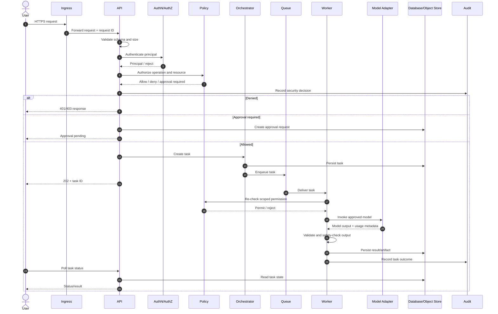

# Data Flow Diagram

This diagram describes a generic request path. Adapt it to the actual implemented services and data stores.

## Data handling rules

- Validate all user input before processing.
- Assign request and task identifiers.
- Store only the data needed for the task.
- Keep credentials out of payloads and logs.
- Do not send confidential/restricted data to an external provider without explicit policy approval.
- Apply retention and deletion rules to prompts, files, outputs, and derived artifacts.
- Protect object storage with scoped access and short-lived download links where applicable.
