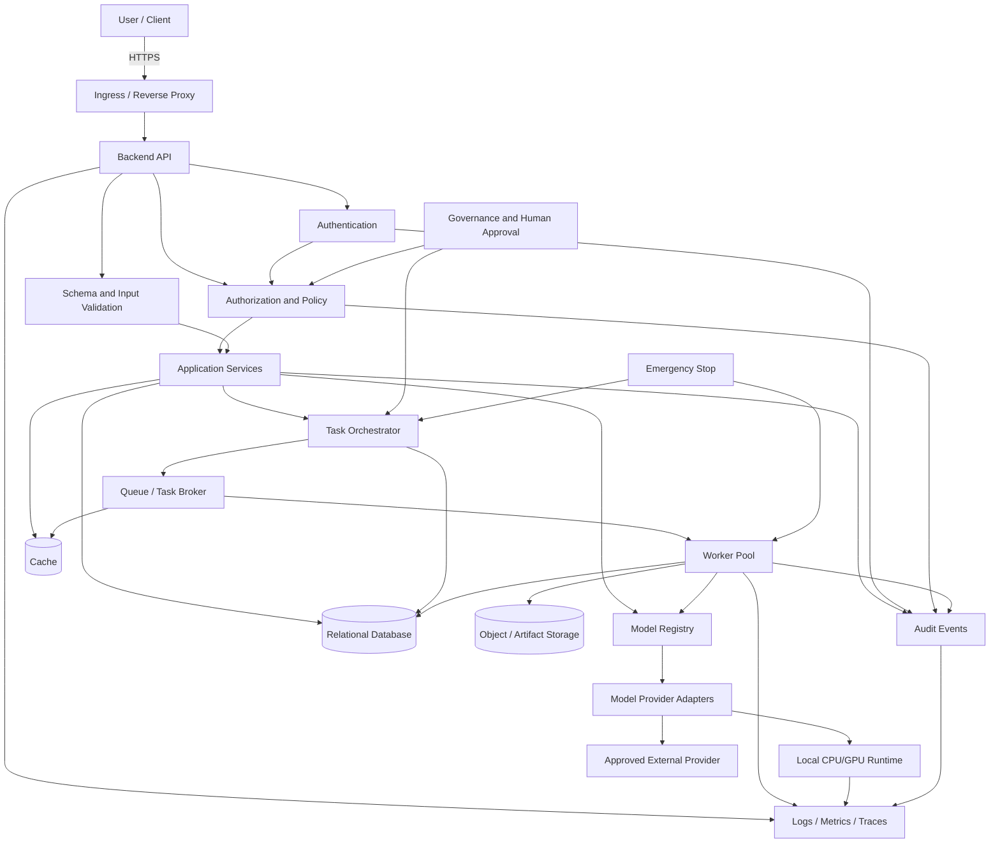

# System Architecture Diagram

This is the intended logical architecture. It is not evidence that all boxes are implemented.

## Trust boundaries

- Client to ingress: untrusted network.
- Ingress to API: authenticated service boundary.
- API to data stores: private service boundary.
- Worker to model runtime: restricted execution boundary.
- Platform to external provider: third-party data-processing boundary.
- Agent to tools: permissioned and sandboxed boundary.

## Design notes

- The policy decision must occur before protected actions.
- External model calls must be explicit and policy-controlled.
- Worker execution must have bounded permissions and resources.
- Audit events must not contain raw secrets.
- Emergency stop must be enforced by the execution path, not merely shown in the UI.
